

# Pundra CSE Smart Portal 25

**A Win32 desktop portal in C for the CSE Department of Pundra University of Science & Technology —
18 academic and campus modules in one dark-themed GUI.**

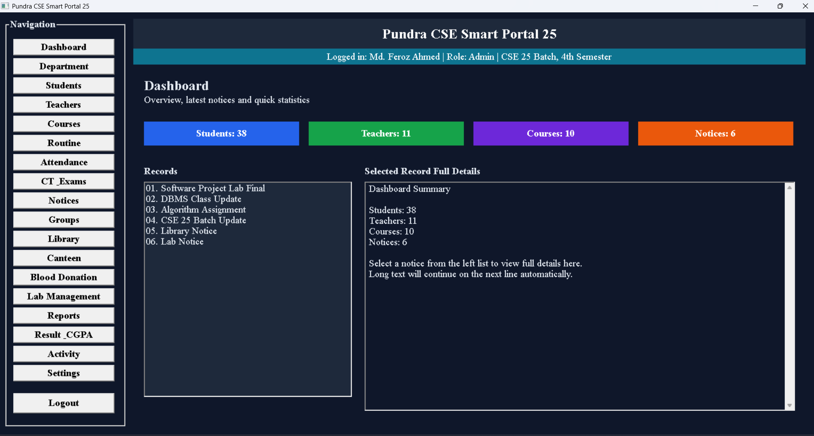

## Contents
[About](#about) · [Highlights](#highlights) · [Modules](#modules) · [Screenshots](#screenshots) ·
[Tech stack](#tech-stack) · [Architecture](#architecture) · [Quick start](#quick-start) · [Build](#build-from-source) ·
[Reset data](#reset-data) · [Troubleshooting](#troubleshooting) · [Roadmap](#roadmap)

## About
Pundra CSE Smart Portal 25 brings everyday department work — students, teachers, courses, routine, attendance,
exams, notices, library, canteen, blood donation and more — into a single Windows application written in **C with
the Win32 API**. It started as a console project and grew into a full GUI with a login screen, sidebar navigation,
dashboard cards and record management for every module.

It ships with real-style default data for the **CSE 25 batch**: 38 students, 11 teachers and 10 courses.

## Highlights
- 🔐 Login, registration and **forgot password** with a 4-digit reset code
- 📊 **Dashboard** with live counts for students, teachers, courses and notices
- 🧭 **Sidebar navigation** across 18 modules, opens maximised and stays responsive on resize
- 📝 **Insert / Update / Delete / Refresh** on every module through a pop-up record form
- 🧮 Built-in **CGPA calculator** and **canteen bill calculator**
- 🕓 **Activity log** of changes
- 💾 Automatic saving to plain-text files — no database server needed
- 🎨 Dark theme with large Times New Roman fonts for readability

## Modules
| Academic | People | Campus services | System |
|---|---|---|---|
| Courses | Students | Library | Dashboard |
| Routine | Teachers | Canteen | Activity |
| Attendance | Department | Blood Donation | Settings |
| CT / Exams | Groups | Lab Management | Logout |
| Result & CGPA | | Notices · Reports | |

## Screenshots
| Login | Dashboard |
|---|---|
| 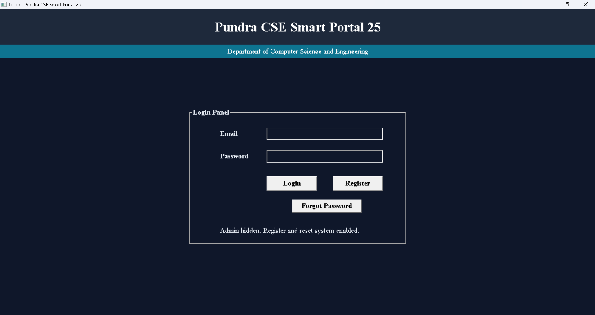 |  |

| Department | Students | Teachers |
|---|---|---|
| 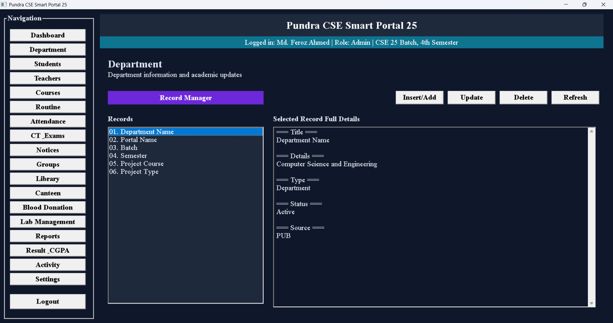 | 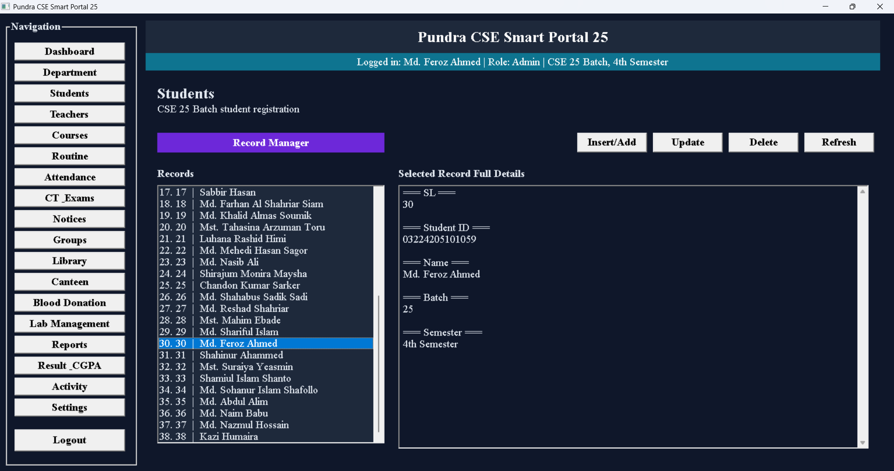 | 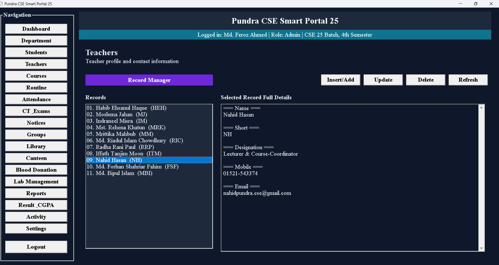 |

| Attendance | Add record form | CT / Exams | Result & CGPA |
|---|---|---|---|
| 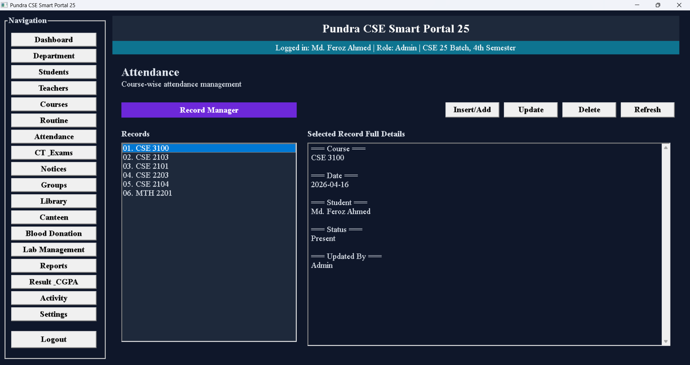 | 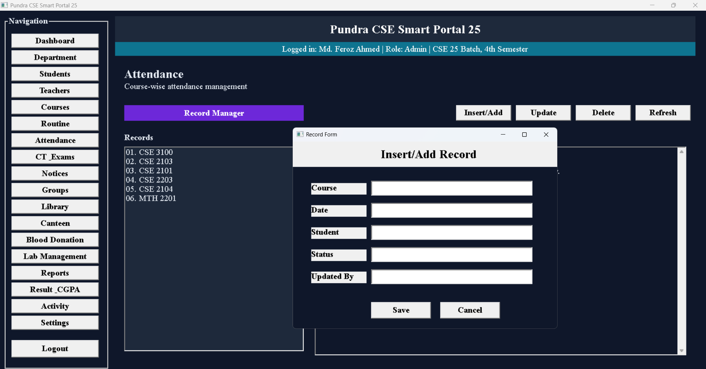 | 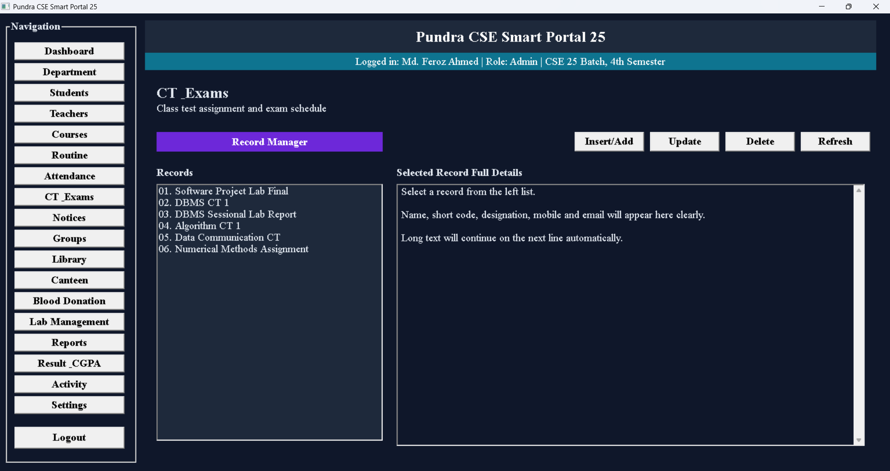 | 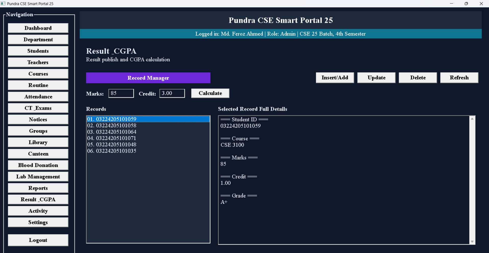 |

More screens: notices, groups, reports, library, canteen, blood donation, labs, settings

| Notices | Groups | Reports | Library |
|---|---|---|---|
| 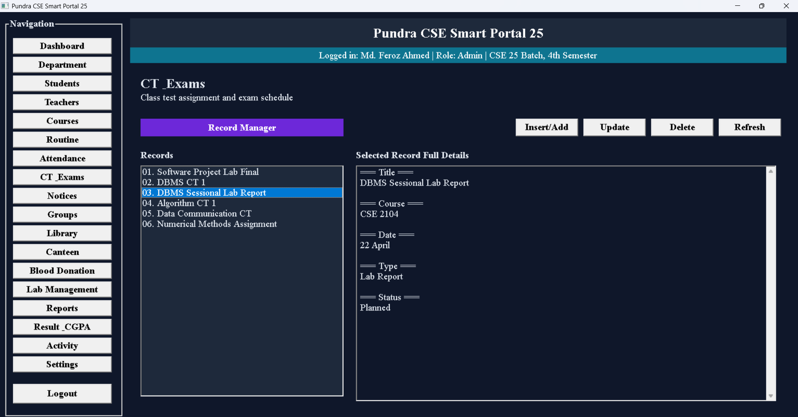 | 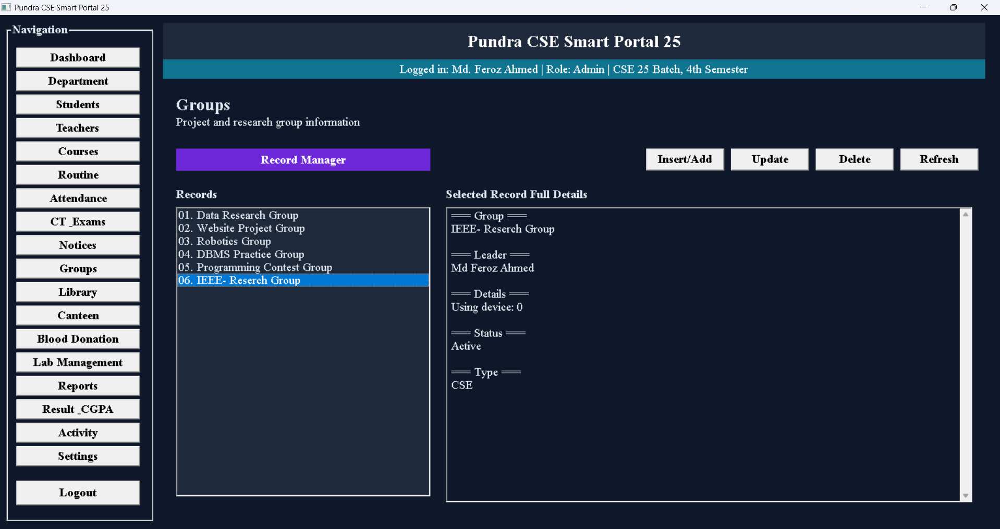 | 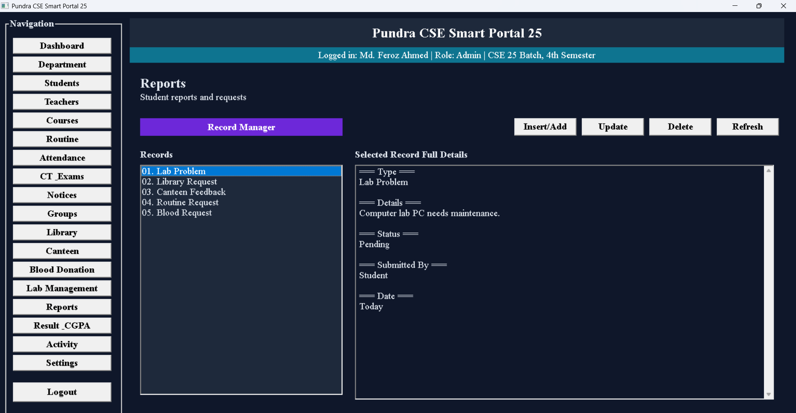 | 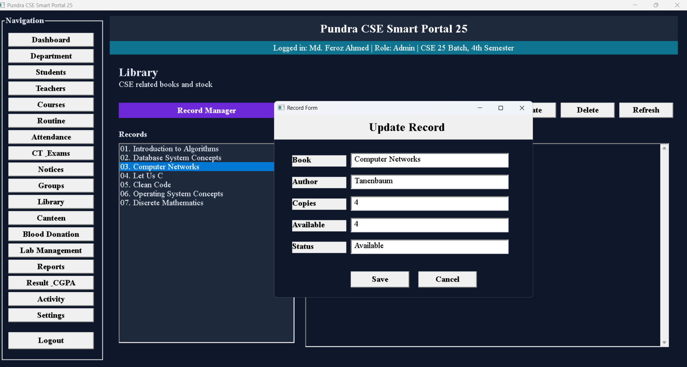 |

| Canteen | Blood donation | Lab management | Settings |
|---|---|---|---|
| 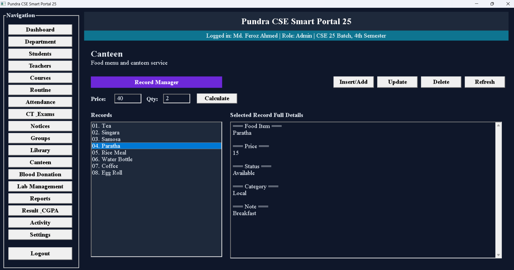 | 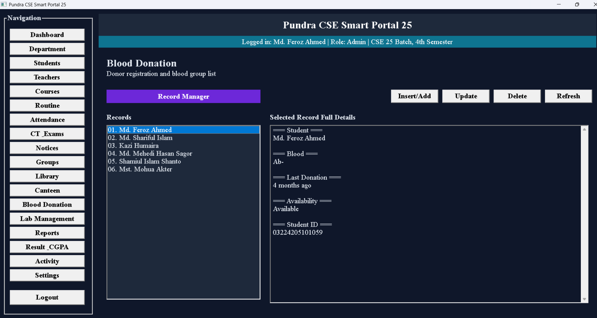 | 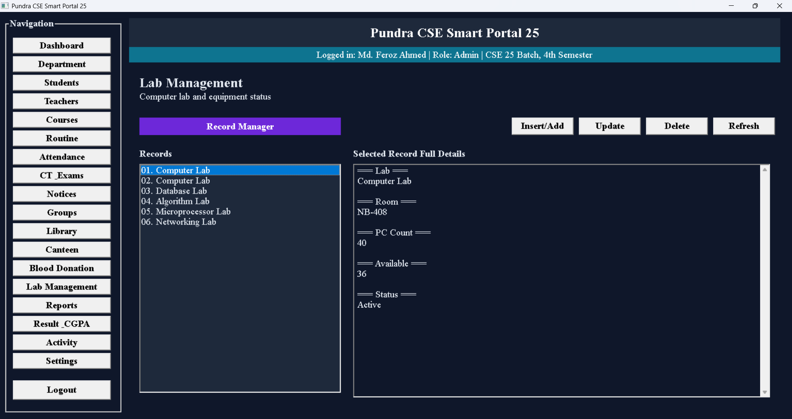 | 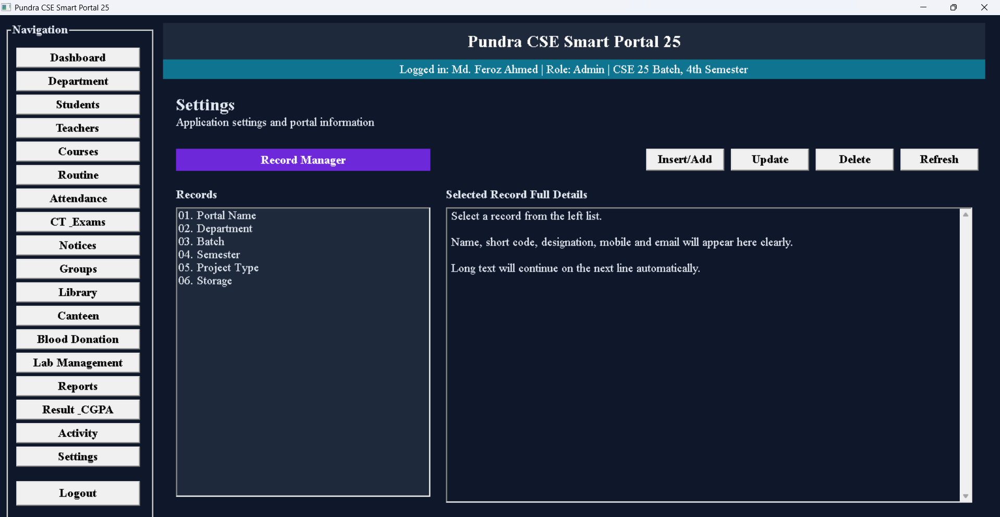 |

## Tech Stack
| Part | Choice |
|---|---|
| Language | C |
| GUI | Win32 API (`STATIC`, `EDIT`, `BUTTON`, `LISTBOX` controls, GDI fonts and brushes) |
| Compiler | GCC on MSYS2 UCRT64 (`-mwindows -lgdi32 -luser32`) |
| Storage | Plain-text files in `data/` |
| OS | Windows 10 / 11 |
